<div align="center">



[](https://git.io/typing-svg)


</div>

---

### `root@subzer030:~# cat about.txt`

```
┌──────────────────────────────────────────────────────────────────────┐
│  ALIAS   : SubZer030                                                 │
│  NAME    : Harry Ken ADJE                                            │
│  ROLE    : Cybersecurity Student @ Epitech                           │
│  FOCUS   : Pentesting · Vulnerability Research · Network Security    │
│  STACK   : C · Python · Bash · Linux                                 │
│  MOTTO   : "Try harder."                                             │
│  STATUS  : [████████████░░░░░░░░] Learning... never stops            │
└──────────────────────────────────────────────────────────────────────┘
```

### `root@subzer030:~# cat /proc/current_missions`

```diff
+ Grinding HackTheBox machines & TryHackMe paths
+ Playing CTFs (pwn / web / crypto / forensics)
+ Learning binary exploitation & reverse engineering
+ Building security tools in C and Python
- Sleeping (deprecated)
```

---

### `root@subzer030:~# ls -la /skills`

<div align="center">

**Languages**


**Arsenal**


</div>

---

### `root@subzer030:~# cat platforms.txt`

<div align="center">

<a href="https://tryhackme.com/p/SubZer030"></a>
<a href="https://profile.hackthebox.com/profile/019c89c6-97d9-71a9-b231-c3adaaf6c052"></a>


</div>

---

### `root@subzer030:~# ./stats.sh`

<div align="center">


<br/>


<br/>


</div>

---

### `root@subzer030:~# ./connect.sh`

<div align="center">

[](https://twitter.com/harryken1497237)
[](https://www.linkedin.com/in/harry-ken-adje-27b693374)
[](https://www.instagram.com/harryken.exe/)
[](https://discord.com/users/1130235491946602608)

</div>

---

<div align="center">

```
root@subzer030:~# exit
Connection closed. See you on the other side. 👾
```

*"There is no patch for human curiosity."*

</div>
